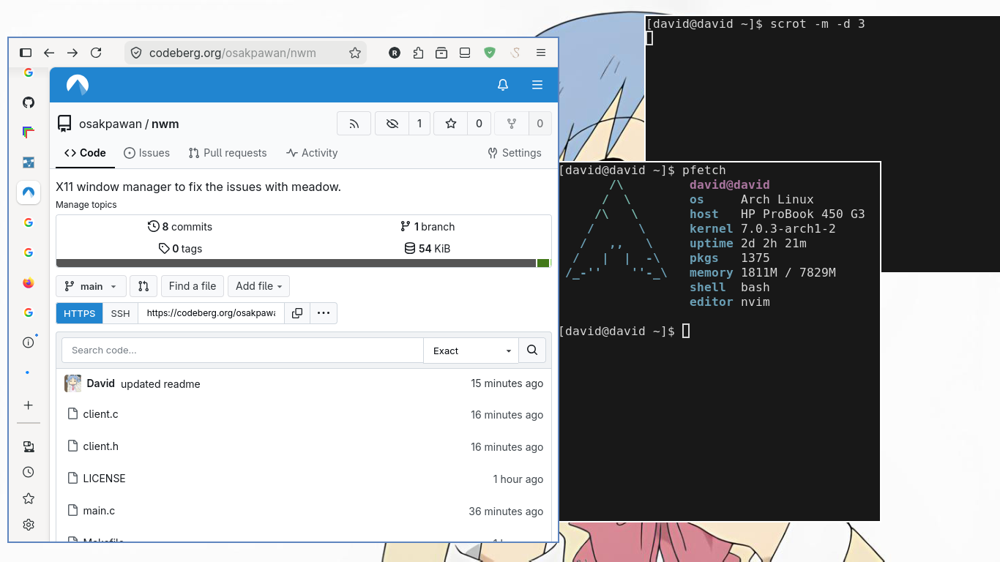

# nwm (new window manager)

X11 window manager to fix the issues with meadow.

### Screenshot

### Actual features 
- opens (yayy)
- does not crash (hopefully)
- basic pointer and keyboard support 
- Application launcher (not really a feature, just uses `dmenu`)
- fixes all the issues on my previous window manager (meadow)

### Things to be added 
- Unique window display system
 

### How to configure 
Edit the macros defined at the top of `main.c` and recompile


## How to run 

There are two ways to run this window manager

1. you can run the window manager as nested window using [Xephyr](https://en.wikipedia.org/wiki/Xephyr). To run simply install it and then using the provided `Makefile`, do:

```bash 
make build && make run
```

> [!NOTE]
> Always use `make run` to run the nested window manager as executing `./nwm` directly will fail 


2. Run directly from the tty, this should be obvious but set your `.xinitrc` to `exec /path/to/nwm` before exiting your current window manager and launching nwm by running `startx`

## Default key bindings 

- Mod + Q = Exit window manager
- Mod + Space = Open application launcher (dmenu by default but can be changed in `config.h`)
- Mod + R to toggle `resize mode`. When in resize mode, use arrow keys to resize window 
- Mod + M to toggle `move mode`. When in move mode, use arrow keys to move window 


## Window colour codes  
Window borders have different colours based on input mode 

- In `resize mode` the window border will have a green colour
- In `move mode` the window border will have a red colour
- When window is inactive, it will have a white border 
- When window is active, it will have a blue border

Have fun :)
